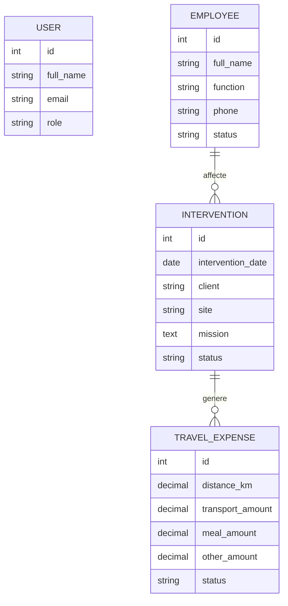

# Analyse fonctionnelle

## Contexte

CAIDELEC souhaite remplacer un systeme basique de planification par une plateforme centralisee permettant a la reception de gerer les affectations quotidiennes, le suivi du personnel et les frais de deplacement des equipes techniques.

## Acteurs

- Administrateur: gere les utilisateurs et les droits d'acces.
- Reception: cree le planning quotidien et affecte les techniciens.
- Manager: suit l'avancement des interventions et la disponibilite des equipes.
- Comptabilite: consulte et exporte les frais mensuels.
- Technicien: execute les interventions affectees.

## Besoins fonctionnels

1. Authentification securisee par email et mot de passe.
2. Consultation des employes et de leur statut: disponible, conge, maladie, absent.
3. Creation et consultation des interventions quotidiennes.
4. Affectation d'une intervention a un employe.
5. Suivi du statut d'une intervention: planifiee, en cours, terminee, annulee.
6. Saisie des frais: distance, transport, repas et autres frais.
7. Generation d'une synthese mensuelle pour la comptabilite.

## Besoins non fonctionnels

- Interface simple et rapide pour la saisie quotidienne.
- Architecture decouplee API RESTful / SPA.
- Validation des donnees cote backend.
- Base de donnees relationnelle PostgreSQL.
- Deploiement reproductible avec Docker Compose.
- Documentation API automatique via Swagger/OpenAPI.

## Modele conceptuel simplifie

## Endpoints principaux

- `POST /api/auth/login`
- `GET /api/employees`
- `POST /api/employees`
- `GET /api/planning`
- `POST /api/planning`
- `GET /api/expenses`
- `POST /api/expenses`
- `GET /api/reports/monthly`
